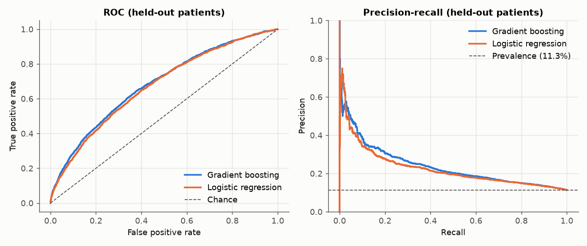
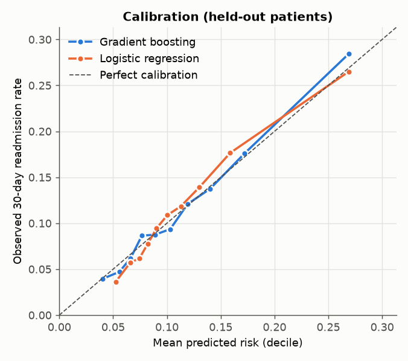
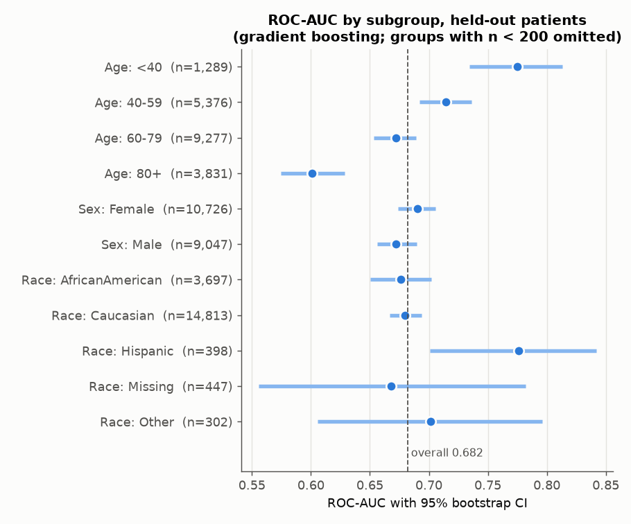
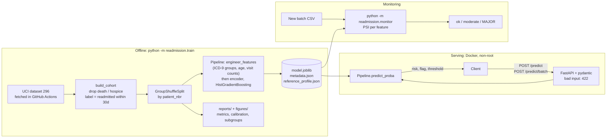

# 30-Day Readmission Risk API

[](https://github.com/lukahere007/readmission-risk-api/actions/workflows/ci.yml)

[](LICENSE)

**Can we flag which diabetic inpatients will be readmitted within 30 days, and serve that
prediction behind an API that someone could actually deploy?**

This repo goes end to end: a correctly built cohort from ~100k real US hospital encounters,
a model evaluated on *patients it has never seen*, calibration and subgroup checks, a
FastAPI service with input validation, a Docker image smoke-tested in CI, and a drift monitor.

## The answer

Moderately, and only a little better than a simple rule. On 19,773 encounters from held-out patients:

| | ROC-AUC (95% CI) | PR-AUC | Brier | Top-10% flag: readmissions caught |
|---|---|---|---|---|
| **Gradient boosting (served)** | **0.682** (0.671–0.695) | **0.239** | **0.0951** | **563 / 2,244 (25%), precision 28%** |
| Logistic regression | 0.672 (0.660–0.684) | 0.226 | 0.0959 | 524 (23%), precision 26% |
| Rule: most prior-year inpatient stays | 0.614 | 0.191 | – | 502 (22%), precision 25% |
| No skill (predict the 11.3% base rate) | 0.500 | 0.113 | 0.1006 | ~224 expected (10%) |

- **Flag the riskiest 10% of discharges** (risk ≥ 0.195) and 28% of those patients come back
  within 30 days, **2.5× the base rate**, catching a quarter of all readmissions.
- **Well calibrated out of the box** (expected calibration error 0.006); a predicted 20% risk
  means about 20%, so no recalibration step was added.
- **The honest comparison is the one-line rule**: the model catches 61 more readmissions per
  ~20k discharges than ranking by prior admissions. Administrative encounter data only
  supports moderate prediction of 30-day readmission; this model doesn't change that.
- **It works worst for the oldest patients** (ROC-AUC 0.60 for age 80+ vs 0.78 for under-40s;
  see [subgroups](#subgroup-check)).



## What this project demonstrates

| Area | What was done |
|---|---|
| Cohort definition | Removed 2,423 encounters discharged to **death or hospice** (disposition codes 11, 13, 14, 19, 20, 21), who cannot be readmitted. The API also rejects them. |
| Leakage control | 23% of patients have several encounters, so the train/test split and CV are **grouped by `patient_nbr`**. |
| Evaluation | ROC-AUC with bootstrap CI, PR-AUC against prevalence, Brier score against the no-skill Brier, calibration curve, a concrete operating point, subgroup analysis. |
| Serving | FastAPI with pydantic schemas (`/health`, `/predict`, `/predict/batch`, `/model-info`). Out-of-range or malformed input returns 422. |
| Packaging | One sklearn `Pipeline` (feature engineering + encoding + model) saved with joblib (0.17 MB), plus `metadata.json` holding training time, data SHA-256, metrics, features and library versions. |
| Deployment | Slim Docker image running as a non-root user. CI builds it, starts it, and curls `/health`, `/predict` and `/predict/batch`. |
| Monitoring | PSI drift report per feature against a stored training profile. |
| Reproducibility | `python -m readmission.train` with a fixed seed. Re-running it reproduced every metric exactly. |

### Does the grouped split matter here? Measured, not assumed

Same model trained 5 times (seeds 0–4) with a random encounter-level split vs a patient-grouped split:

| Split | Test patients also in train | Test ROC-AUC (mean ± sd, 5 seeds) |
|---|---|---|
| Random, by encounter | ~6,730 | 0.674 ± 0.004 |
| Grouped, by patient | 0 | 0.671 ± 0.008 |

About 6,700 test patients leak into training under a random split, but the optimism is only
~0.003 AUC, well within seed-to-seed noise. These features don't fingerprint individual
patients, so the leak barely helps the model. The grouped split is still the correct protocol;
the point is that it was measured (`reports/leakage_random_vs_grouped.csv`).

## Calibration



Observed and predicted rates agree to within about 1 percentage point in every risk decile
(`reports/calibration_test.csv`). That matters because the API returns a probability, not
just a rank.

## Subgroup check



- **Age is a real gap.** Discrimination falls with age: 0.775 for under-40s, 0.601 for 80+.
  At the shared threshold the model catches 43% of under-40 readmissions but only 18% for 80+.
- **Sex and the two large race groups** (Caucasian 0.680, African American 0.676) have
  overlapping CIs. No gap is shown, which is **not** proof of fairness.
- **Smaller groups** (Hispanic n=398, Other n=302, race missing n=447, Asian n=116) have CIs
  too wide to conclude anything. Race is as recorded by hospitals, not self-identified.

Full table: `reports/subgroups_test.csv` and the [model card](docs/model_card.md).

## Architecture



## Run the API locally

```bash
git clone https://github.com/lukahere007/readmission-risk-api.git
cd readmission-risk-api

# Option A: Docker
docker compose up --build            # or: docker build -t readmission-api . && docker run -p 8000:8000 readmission-api

# Option B: plain Python 3.11
python -m pip install -r requirements.txt
uvicorn readmission.api:app --port 8000
```

Interactive docs are at http://localhost:8000/docs. Example request (a real test-set encounter):

```bash
curl -s -X POST http://localhost:8000/predict \
     -H 'Content-Type: application/json' \
     -d @examples/single.json
```

```json
{"risk":0.0824,"flag_for_follow_up":false,"threshold":0.1949,"model_version":"1.0.0"}
```

`examples/single.json` is one encounter in the UCI field format (`"age": "[70-80)"`,
`"diag_1": "428"`, `"number_inpatient": 0`, ...). The optional fields (medications, lab results)
default to "No" / "None". Batch scoring takes `{"encounters": [...]}` with up to 1,000 records
(`examples/batch.json`). Invalid input is rejected with 422, for example
`discharge_disposition_id: 11` ("Expired"):

```json
{"detail":[{"type":"value_error","loc":["body","discharge_disposition_id"],
  "msg":"Value error, encounters discharged to death or hospice are outside the model's intended use", "...": "..."}]}
```

`GET /model-info` returns `models/metadata.json` (training date, data hash, test metrics,
feature list, scikit-learn version).

## Monitoring

`python -m readmission.monitor <batch.csv>` engineers the same features as the model and
computes the **Population Stability Index** for each one against `models/reference_profile.json`
(training distribution). PSI ≥ 0.1 is flagged moderate and ≥ 0.25 major; `--fail-on-major`
makes it exit non-zero for use in a scheduled job.

`python scripts/drift_demo.py` runs it on three batches:

| Batch | Features PSI ≥ 0.1 | PSI ≥ 0.25 | ROC-AUC | Mean predicted vs observed |
|---|---|---|---|---|
| Held-out test patients | 0 | 0 | 0.682 | 11.3% vs 11.3% |
| Top 20% `encounter_id` of test (proxy for "later"*) | 5 | 1 (medical specialty 0.36) | 0.696 | 11.7% vs 10.5% |
| Perturbed test copy (older, more meds, more A1c tests) | 4 | 2 (HbA1c 0.33, medications 0.32) | – | 12.5% predicted |

\*The dataset doesn't document that ids are chronological. On that slice the alerts were
real: the ranking held up, but the model over-predicted by ~1 point, a calibration drift
worth checking. Sample batches for trying the CLI are in `data/demo/`.

## Reproduce everything

```bash
python -m pip install -r requirements.txt
python scripts/fetch_data.py        # re-download from UCI (the snapshot is already committed)
python -m readmission.train         # cohort, CV, leakage check, test metrics, figures, model artefact
python scripts/drift_demo.py        # PSI monitoring demo
python -m pytest -q                 # data prep, PSI, schema validation, API, model
```

Training takes a few minutes on a laptop CPU (`--fast` skips CV and the leakage experiment).

## Project structure

```
├── src/readmission/
│   ├── data.py          # loading, cohort rules, ICD-9 grouping, feature engineering
│   ├── models.py        # logistic regression + gradient boosting pipelines
│   ├── evaluate.py      # metrics, calibration, operating point, subgroup table
│   ├── train.py         # one-command training + evaluation + artefact export
│   ├── schemas.py       # pydantic request/response models
│   ├── api.py           # FastAPI app
│   ├── monitoring.py    # PSI + training profile
│   ├── monitor.py       # drift CLI
│   └── plots.py
├── models/              # model.joblib, metadata.json, reference_profile.json
├── reports/             # metrics.json, calibration, subgroups, leakage, drift CSVs
├── figures/             # README figures
├── docs/model_card.md   # intended use, data, metrics, subgroups, limitations
├── data/raw/            # UCI snapshot (csv.gz) + IDs mapping + MANIFEST with SHA-256
├── data/demo/           # small drift-demo batches
├── examples/            # request bodies for /predict and /predict/batch
├── scripts/             # fetch_data.py, drift_demo.py
├── tests/               # pytest
├── Dockerfile, docker-compose.yml
└── .github/workflows/   # ci.yml (tests + Docker smoke test), fetch-data.yml
```

## Limitations

- **Not for clinical use.** This is a portfolio project. It has no prospective validation
  and no clinical review.
- **Old, narrow data**: 1999–2008, US hospitals only, diabetic inpatient encounters of 1–14
  days. ICD-9 coding, diabetes drugs, and readmission incentives have all changed since.
- **Label gaps**: readmissions to hospitals outside the source database count as "not
  readmitted", and planned and unplanned readmissions are not distinguished.
- **Modest signal**: AUC ~0.68 from administrative fields. Most of the useful signal is
  prior utilisation.
- The top-10% threshold was set on the same test set used for reporting. A deployment would
  fix it on separate data and size it to follow-up capacity.
- Subgroup analysis covers discrimination and threshold behaviour only, not within-group
  calibration or intersections.

See [docs/model_card.md](docs/model_card.md) for the full model card.

## Data and licence

- **Data**: Strack B, DeShazo JP, Gennings C, Olmo JL, Ventura S, Cios KJ, Clore JN.
  *Impact of HbA1c Measurement on Hospital Readmission Rates: Analysis of 70,000 Clinical
  Database Patient Records.* BioMed Research International 2014:781670.
  doi:[10.1155/2014/781670](https://doi.org/10.1155/2014/781670). Distributed by the
  [UCI Machine Learning Repository (id 296)](https://archive.ics.uci.edu/dataset/296) under
  **CC BY 4.0**. The committed snapshot in `data/raw/` was downloaded by the `Fetch data`
  workflow; `MANIFEST.json` records the source URL and checksums. ICD-9 groupings follow
  Table 2 of the paper.
- **Code**: MIT, see [LICENSE](LICENSE).
